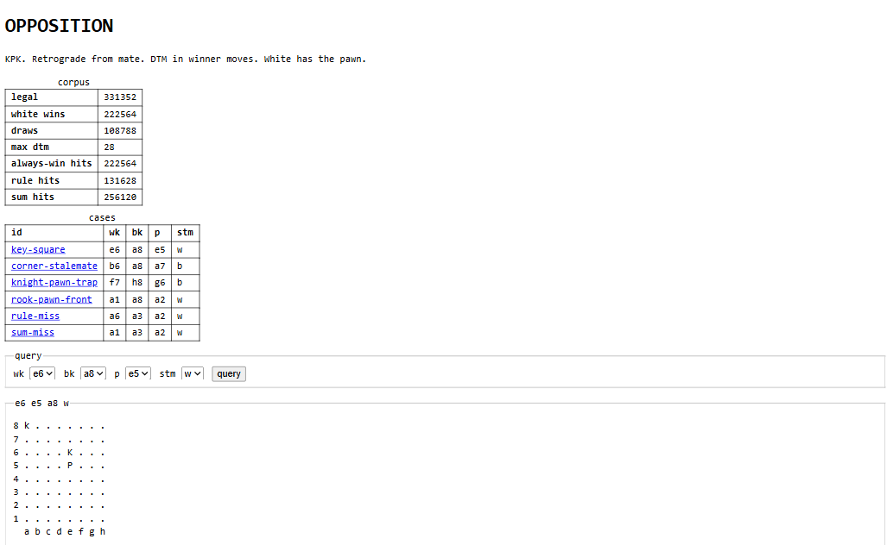

# Opposition

White has a king and a pawn. Black has a king. I started from checkmate and walked backward through every position that can actually happen. If one move leaves the other side lost, that position is a win. If every move does that, it is a loss. The rest are draws. I counted the moves.



When the pawn promotes it becomes a queen or a rook, so I walked those two endings the same way first. The longest wins are the ones the books already printed: 10 moves with the queen, 16 with the rook, and 28 with the pawn.

Then I tried two guesses against every label. One is a rule I copied: two of three facts, and I call it a win. It does worse than the lazy guess of calling everything a win. The other is a small weighted sum. I walk the error backward through it and nudge the weights. That one does better, and it still misses some.

## How to run it

```bash
npm install
npm test
npm run dev
```

Then open [http://127.0.0.1:47291](http://127.0.0.1:47291).

The pawn is White's, and it moves up the board. There are no other pieces. I left the fifty-move rule out, because this ending is over before that matters.

The walk lives in `src/lib/opposition/engine.ts`. The two guesses live in `src/lib/opposition/guess.ts`.
